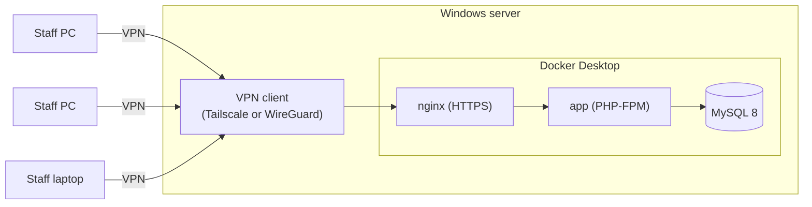

# GSONEO Deployment Guide (Windows)

How to run GSONEO on **one Windows machine**, with staff reaching it through a **VPN**: one server, many user devices connected to it (one-to-many).

Written for Windows 10/11 with Docker Desktop. Windows Server works the same way; where Windows 11 **Home** is more limited, it is called out.

For how the system works internally, see [DOCUMENTATION.md](DOCUMENTATION.md). For local development, see the [README](../README.md).

## Contents

1. [What is being deployed](#1-what-is-being-deployed)
2. [Why a single server](#2-why-a-single-server)
3. [Preparing the Windows machine](#3-preparing-the-windows-machine)
4. [Docker Desktop](#4-docker-desktop)
5. [Installing the application](#5-installing-the-application)
6. [VPN: one server, many users](#6-vpn-one-server-many-users)
7. [Windows Firewall](#7-windows-firewall)
8. [One address for everyone](#8-one-address-for-everyone)
9. [HTTPS](#9-https)
10. [Backups](#10-backups)
11. [Updating the application](#11-updating-the-application)
12. [Monitoring and what happens when something fails](#12-monitoring-and-what-happens-when-something-fails)
13. [Go-live checklist](#13-go-live-checklist)

---

## 1. What is being deployed

One Windows machine runs everything — the web server, the application and the database, all in Docker — and joins the VPN. Every user's computer joins the same VPN. Nothing is exposed to the open internet: the application answers only to devices already inside the tunnel.



How a request flows:

1. The user's device connects to the VPN and gets an address on it.
2. The browser opens `https://gsoneo.lgu.local`, which resolves to the server's **VPN** address.
3. Docker Desktop passes the request to nginx, which serves it and hands PHP to the app, which talks to the database beside it.

Office staff, staff at another office and staff working from home are all the same thing: VPN clients. Adding a user means issuing one more VPN profile — see [section 6](#6-vpn-one-server-many-users).

---

## 2. Why a single server

**GSONEO must have exactly one database that accepts writes.** The code depends on it in several places:

| What | Why it needs one database |
|---|---|
| PR numbers (`PR-2026-0001`), canvass numbers (`CANVAS-000001`), PO, RIS and SSMI numbers | Generated as "highest existing + 1" under a row lock (`lockForUpdate`). Two databases would hand out the same number twice. |
| Sessions, cache and the queue | Stored in database tables (`SESSION_DRIVER=database`, `CACHE_STORE=database`, `QUEUE_CONNECTION=database`). |
| Audit trail | Written on changes and also on page views. |
| Roles & permissions, users, default-password checks | Must be identical for everyone, immediately. |

So one machine holds the single source of truth and everyone connects to it. Deployment, backups and updates stay in one place.

**The trade-off to accept:** if that machine or the VPN is down, nobody can use GSONEO. Mitigate it with the backups in [section 10](#10-backups) and the checks in [section 12](#12-monitoring-and-what-happens-when-something-fails) — not with a second copy of the system, for the reasons at the end of section 12.

---

## 3. Preparing the Windows machine

A Windows desktop makes a workable server, but only after it stops behaving like a desktop. Everything in this section is about that.

### 3.1 Which machine

- **Dedicated, not someone's daily workstation.** Whoever uses it for other work will eventually close Docker Desktop, install something that reboots, or shut it down on the way home.
- **Sizing:** 4 cores, 8 GB RAM (16 GB is comfortable — WSL2 and MySQL both want memory) and an SSD with 100 GB free.
- **Edition:** Windows 11 **Pro** is worth the upgrade for a server. On **Home** you do not get Remote Desktop *hosting* (you must sit at the machine or use another remote tool), you cannot join a domain (so no certificates from the LGU's internal CA — see [section 9](#9-https)), and there is no Group Policy or BitLocker. Home still runs everything in this guide.
- **UPS.** A desktop that loses power mid-write can corrupt the database. This is the cheapest insurance on the list.

### 3.2 Network

Use **wired Ethernet**, and give the machine a **fixed address** — either a DHCP reservation on the router (easiest, survives reinstalls) or a static configuration:

```powershell
Get-NetIPAddress -AddressFamily IPv4 | Where-Object { $_.IPAddress -notlike '127.*' } | Format-Table IPAddress, InterfaceAlias, PrefixOrigin
```

> This machine is currently on **Wi-Fi with a DHCP address** (`192.168.1.18`). Both need changing before go-live: Wi-Fi drops and DHCP addresses move, and either one silently breaks every user's `hosts` entry and the certificate.

### 3.3 Never sleep, always on

Modern standby disconnects the network, which takes the server offline while it looks "on".

```powershell
powercfg /change standby-timeout-ac 0
powercfg /change hibernate-timeout-ac 0
powercfg /change monitor-timeout-ac 15
powercfg /hibernate off
```

Then, in **Settings → System → Power**, confirm nothing is set to sleep on AC. Leave the screen timeout alone — a dark monitor is fine, a sleeping machine is not.

In the BIOS/UEFI, enable **restore power state after power loss** so the machine comes back by itself after an outage.

### 3.4 Start without a person signing in

This is the one that catches people out: **Docker Desktop starts when a user signs in, not when Windows boots.** After an unattended reboot — a Windows update at 3 a.m. — the machine is up and GSONEO is down until someone logs in.

Pick one:

| Approach | What to do | Notes |
|---|---|---|
| **Automatic sign-in** (simplest) | `netplwiz` → clear "Users must enter a user name and password", enter the account's password. Then in Docker Desktop: **Settings → General → Start Docker Desktop when you sign in**. | The machine boots straight into a signed-in desktop. Keep it physically secure — anyone at the keyboard is already logged in. Lock the screen with a keyboard shortcut after boot if the machine sits in the open. |
| **Docker Engine in WSL2** | Install Docker Engine inside the existing `Ubuntu` distro instead of using Docker Desktop, and start it with a scheduled task at boot (`wsl -d Ubuntu -u root service docker start`). | No sign-in needed, no licence question ([section 4](#4-docker-desktop)), but you manage Docker yourself. |

Whichever you choose, **test it**: reboot the machine, do not sign in, wait five minutes, and open GSONEO from another PC.

### 3.5 Windows Update

Updates will reboot this machine. Make them predictable:

- **Settings → Windows Update → Advanced options → Active hours:** cover the whole working day.
- Set **Restart this device as soon as possible** off, and notify instead.
- On Pro, you can also defer feature updates. On Home you cannot — one more reason to prefer Pro.

After any reboot, confirm the containers came back (`docker compose ps`).

### 3.6 Antivirus and the clock

- **Exclusions.** Add the project folder, Docker's data (`%LOCALAPPDATA%\Docker`) and the WSL virtual disks to Microsoft Defender's exclusions, or real-time scanning will slow every request. **Settings → Privacy & security → Virus & threat protection → Exclusions.**
- **Clock.** Audit timestamps depend on it: `w32tm /resync`, and confirm **Set time automatically** is on. The machine's own zone is separate from the application's — that is `APP_TIMEZONE` in `.env` ([section 5.2](#52-configure-env)).

---

## 4. Docker Desktop

Install Docker Desktop with the **WSL2** backend (this machine: Docker Desktop 4.88.1, engine 29.7.2, with a `docker-desktop` and an `Ubuntu` distro).

**Licence check before go-live.** Docker Desktop is free for personal use, education and small businesses, but requires a paid subscription for larger organisations — at the time of writing, the threshold is 250+ employees or $10M+ annual revenue. An LGU may well be over it. Check the current terms, and if you are over, either buy the subscriptions or use **Docker Engine inside WSL2**, which is free and runs the same `docker compose` commands. This is a procurement question, not a technical one, so settle it early.

**Where to put the project.** Docker Desktop reaches files on `C:\` through a translation layer, and PHP opens a great many small files per request. Keeping the code on `C:\` works and is fine for a pilot; for production, put the project **inside the WSL2 filesystem** instead — `\\wsl.localhost\Ubuntu\opt\gsoneo` from Explorer, `/opt/gsoneo` from inside Ubuntu — where bind mounts are dramatically faster. Clone it there with WSL's own `git`, not by copying from `C:\`.

Also raise Docker Desktop's memory allocation if the default is low: **Settings → Resources**, 4–6 GB.

---

## 5. Installing the application

Run these from PowerShell in the project folder. (PowerShell 5.1 has no `&&`; each command is on its own line deliberately.)

### 5.1 Get the code

```powershell
git clone <repository-url> C:\gsoneo
cd C:\gsoneo
Copy-Item .env.example .env
```

### 5.2 Configure `.env`

```dotenv
APP_ENV=production
APP_DEBUG=false
APP_URL=https://gsoneo.lgu.local
LOG_LEVEL=warning

# Philippine time. Both are needed: the first decides what is written, the
# second how the database reads it back. See DOCUMENTATION.md § Dates and times.
APP_TIMEZONE=Asia/Manila
DB_TIMEZONE=+08:00

DB_HOST=db
DB_DATABASE=GSONEO
DB_USERNAME=laravel_user
DB_PASSWORD=<long random password>

SESSION_SECURE_COOKIE=true      # once HTTPS is on (section 9)
USER_TEMP_PASSWORD_HOURS=72     # how long a one-time password from an admin works
OCRSPACE_KEY=<key>
```

- **Never reuse** the development passwords from `docker-compose.yaml` (`secret`, `rootsecret`).
- **`APP_KEY`:** generated once in 5.4 and then kept. Changing it signs everyone out and breaks anything encrypted.
- The server needs outbound internet for OCR (`api.ocr.space`); the users do not.

### 5.3 Production compose file

Keep the development file for developers, and add `docker-compose.prod.yaml` on the server:

```yaml
services:
  app:
    restart: unless-stopped
    env_file: .env

  nginx:
    restart: unless-stopped
    ports:
      # Bound to the VPN address only — see section 7. Use the server's own
      # VPN address here (Tailscale 100.x.y.z, or WireGuard 10.10.0.1).
      - "100.x.y.z:80:80"
      - "100.x.y.z:443:443"
    volumes:
      - ./:/var/www
      - ./docker/nginx/production.conf:/etc/nginx/conf.d/default.conf
      - ./docker/nginx/certs:/etc/nginx/certs:ro

  db:
    restart: unless-stopped
    ports: !reset []            # do NOT publish 3306 on the host
    environment:
      MYSQL_DATABASE: ${DB_DATABASE}
      MYSQL_USER: ${DB_USERNAME}
      MYSQL_PASSWORD: ${DB_PASSWORD}
      MYSQL_ROOT_PASSWORD: ${DB_ROOT_PASSWORD}
```

`restart: unless-stopped` is what brings the containers back after a reboot, provided Docker itself starts ([section 3.4](#34-start-without-a-person-signing-in)).

**Fix before production:** `docker/php/Dockerfile` installs the Node packages but never runs `npm run build`, so the image only contains whatever `public/build` was committed. Add `RUN npm run build` after `COPY . .` in the first stage, or build the assets on the server as in 5.4.

### 5.4 First start

```powershell
docker compose -f docker-compose.yaml -f docker-compose.prod.yaml up -d --build
docker compose exec app composer install --no-dev --optimize-autoloader
docker compose exec app php artisan key:generate
docker compose exec app php artisan migrate --force --seed
docker compose exec app npm ci
docker compose exec app npm run build
docker compose exec app php artisan config:cache
docker compose exec app php artisan route:cache
docker compose exec app php artisan view:cache
docker compose exec app php artisan erd:generate
```

`key:generate` is for the first install only; `erd:generate` refreshes the diagram on the Docs page (it reads the live schema, so run it after migrations).

Then:

1. Issue the Superadmin a one-time password with `docker compose exec app php artisan user:one-time-password <emp_id>`, sign in with it, and choose your own.
2. Review **Utils → Roles & Permissions**.
3. Add users from **User List** — and issue each of them a VPN profile.

---

## 6. VPN: one server, many users

### 6.1 Choosing one

| | **Tailscale** (recommended) | **WireGuard for Windows** | **Router / firewall VPN** | **Radmin VPN, Hamachi** |
|---|---|---|---|---|
| Needs a public IP or port forwarding | No | **Yes** (UDP 51820) | Yes | No |
| Who can join | Each person signs in with their own account | Only a device whose key you added | The router's own user list | **Anyone with the shared network password** |
| Removing one person | Revoke that device in the admin console | Remove that peer | Delete that user | Change the password **for everyone** |
| Seeing who is connected | Admin console | `wg show` | Router's status page | No |
| Non-Windows devices | Yes | Yes | Usually | **No — Windows only** |
| Runs on this machine today | Already installed (1.102.4, currently stopped) | Installs in minutes | n/a | Would work, with the caveats above |

**Take Tailscale** unless you have a reason not to: it is already on this machine, it needs no port forwarding (the usual blocker on an LGU connection), and it is the only option in that table that gives you per-person identity, one-click revocation and a list of who is connected — which is what a system with an audit trail and per-user roles ought to have.

**Radmin VPN** is fine for a short pilot with test data on a Windows-only group. It is not suitable for live procurement records: one shared password is the only access control, a departing staff member keeps access until you rotate it for everybody, and you cannot see who is connected.

### 6.2 Tailscale

On the server:

1. Start Tailscale and sign in with the LGU account that will own the network (`tailscale up`, or the tray icon).
2. In the admin console (`login.tailscale.com`), open the machine's row and **disable key expiry** — otherwise the server signs itself out every few months.
3. Note its `100.x.y.z` address; that is the address to use in [section 5.3](#53-production-compose-file) and section 8.

```powershell
& "C:\Program Files\Tailscale\tailscale.exe" status
& "C:\Program Files\Tailscale\tailscale.exe" ip -4
```

**Adding a user:** invite them from the admin console; they install Tailscale and sign in with their own account. Nothing is shared between staff, and nothing is typed into a profile file.

**Removing a user:** delete their device (or remove the user) in the admin console. Then disable their GSONEO account in **User List** as well — the two are separate doors.

**Worth setting once:**
- **Device approval**, so a new machine cannot join until you approve it.
- An **ACL** limiting staff devices to the server on port 443, rather than to each other.
- **MagicDNS**, which gives the server a stable name and removes the need for `hosts` files ([section 8](#8-one-address-for-everyone)).

### 6.3 WireGuard for Windows (self-hosted alternative)

Choose this if you want no third party at all and can get UDP `51820` forwarded to the server from a public address.

Install WireGuard for Windows, then **Add Tunnel → Add empty tunnel** — it generates a key pair and installs the tunnel as a Windows service that starts at boot. The server's config:

```ini
[Interface]
PrivateKey = <generated for you>
Address = 10.10.0.1/24
ListenPort = 51820

# One [Peer] block per user device

[Peer]
# Juan dela Cruz — GSO desktop
PublicKey = <that device's public key>
AllowedIPs = 10.10.0.11/32
```

**Adding a user.** Generate a key pair for their device (`wg.exe` ships with WireGuard):

```powershell
& "C:\Program Files\WireGuard\wg.exe" genkey | Tee-Object user-juan.key | & "C:\Program Files\WireGuard\wg.exe" pubkey | Out-File -Encoding ascii user-juan.pub
```

Add a `[Peer]` block with that public key and the next free address, save the tunnel, then give the user this profile:

```ini
[Interface]
PrivateKey = <contents of user-juan.key>
Address = 10.10.0.11/32

[Peer]
PublicKey = <server public key>
Endpoint = <public IP or hostname>:51820
# Split tunnel: only GSONEO traffic goes through the VPN.
AllowedIPs = 10.10.0.1/32
PersistentKeepalive = 25
```

- Each device gets its **own** key pair and `/32` address. Never share one profile between people — the address is what the audit trail records.
- **Send profiles securely**, in person or through a channel the user already authenticates to. The file contains a private key.
- **Keep a register** of address → person and device, so an address in the audit trail can be turned back into a name.
- **Removing a user:** delete their `[Peer]` block and save.

### 6.4 Whichever you choose

Tell users plainly: **the VPN must be connected before GSONEO will open.** Most support calls with this setup are a tunnel that was switched off.

---

## 7. Windows Firewall

Two layers, and the first matters most.

**1. Publish only on the VPN adapter.** Docker Desktop publishes container ports through its own process, which listens on every interface by default — including Wi-Fi and Ethernet. Binding the ports to the server's VPN address in `docker-compose.prod.yaml` ([section 5.3](#53-production-compose-file)) means the app is never offered to the office LAN or to anything else the machine is plugged into.

**2. Add a firewall rule as well** (PowerShell as Administrator; use the VPN adapter's name — `Tailscale`, or the WireGuard tunnel's name):

```powershell
New-NetFirewallRule -DisplayName "GSONEO HTTPS (VPN only)" -Direction Inbound -Protocol TCP -LocalPort 443 -InterfaceAlias "Tailscale" -Action Allow
```

For WireGuard, also allow the tunnel itself to be reached from outside:

```powershell
New-NetFirewallRule -DisplayName "WireGuard" -Direction Inbound -Protocol UDP -LocalPort 51820 -Action Allow
```

**Then check the result from a PC that is not on the VPN**: `https://192.168.1.18` should fail to connect. If it loads, the ports are still published on the LAN — fix the bind address in the compose file. Repeat this check after any Docker Desktop upgrade.

MySQL's 3306 should not be published at all; the app reaches the database inside Docker's own network.

---

## 8. One address for everyone

Use **one hostname** — `gsoneo.lgu.local` — pointing at the server's **VPN** address. One hostname keeps session cookies, the certificate and `APP_URL`'s generated links all agreeing, whether a user is in the office or at home.

| How | Notes |
|---|---|
| **Tailscale MagicDNS** | The server gets a name automatically (`gsoneo.<your-tailnet>.ts.net`) with no configuration on any device. Use that name as `APP_URL` and skip `hosts` files entirely — and it pairs with a real certificate ([section 9](#9-https)). |
| **`hosts` file on each PC** | Add `100.x.y.z  gsoneo.lgu.local` to `C:\Windows\System32\drivers\etc\hosts` (edit as Administrator). Fine for a small number of devices; tedious to change later, because a changed server address means visiting every PC. |
| **Office DNS / router entry** | A static host entry, if the LGU runs its own DNS. Covers office PCs; laptops off-site still need the row above. |

---

## 9. HTTPS

Users type passwords, so serve HTTPS even though the traffic is already inside the VPN.

| Option | When |
|---|---|
| **Tailscale certificate** (`tailscale cert`) | Best on Windows with Tailscale: a real, publicly trusted certificate for the machine's `ts.net` name, with nothing to install on staff devices. Renew it on a schedule ([section 10](#10-backups) shows the Task Scheduler pattern). |
| **The LGU's internal CA** | If the LGU runs Windows AD CS, issue a `gsoneo.lgu.local` certificate and install the CA certificate on staff PCs once. Note this needs the server domain-joined — **not possible on Windows 11 Home**. |
| **Self-signed** | Testing only. Browsers warn, and staff learn to click through warnings — which is the habit you least want them to have. |

Place the certificate and key as PEM files in `docker\nginx\certs\`, since nginx reads PEM, not PFX. Converting an exported PFX:

```powershell
docker run --rm -v "${PWD}\docker\nginx\certs:/certs" alpine/openssl pkcs12 -in /certs/gsoneo.pfx -clcerts -nokeys -out /certs/gsoneo.crt -passin pass:<pfx password>
docker run --rm -v "${PWD}\docker\nginx\certs:/certs" alpine/openssl pkcs12 -in /certs/gsoneo.pfx -nocerts -nodes -out /certs/gsoneo.key -passin pass:<pfx password>
```

After HTTPS works, set `SESSION_SECURE_COOKIE=true` and run `docker compose exec app php artisan config:cache`.

---

## 10. Backups

With one machine, backups are the whole recovery plan — and a copy that lives only on that machine is not a backup. Send it somewhere else: a NAS, an external drive rotated off-site, or another office's machine.

### 10.1 The script

Save as `C:\gsoneo\backup.ps1`. It dumps **inside** the container and copies the file out, rather than piping through PowerShell — PowerShell's redirection would corrupt the compressed stream.

```powershell
$ErrorActionPreference = 'Stop'
$stamp  = Get-Date -Format 'yyyy-MM-dd'
$local  = 'D:\Backups\gsoneo'
$remote = '\\NAS\backups\gsoneo'      # or another machine, or a rotated external drive

New-Item -ItemType Directory -Force -Path $local | Out-Null

docker exec laravel-db sh -c 'exec mysqldump --single-transaction --routines -uroot -p"$MYSQL_ROOT_PASSWORD" GSONEO | gzip > /tmp/gsoneo.sql.gz'
if ($LASTEXITCODE -ne 0) { throw "mysqldump failed" }

docker cp "laravel-db:/tmp/gsoneo.sql.gz" "$local\gsoneo-$stamp.sql.gz"
docker exec laravel-db rm -f /tmp/gsoneo.sql.gz

# Uploaded files that are not in the database: the logos and watermark set on Document Branding.
# The folder only exists once a logo has been uploaded.
$backups  = @("$local\gsoneo-$stamp.sql.gz")
$branding = 'C:\gsoneo\storage\app\private\branding'
if (Test-Path $branding) {
    Compress-Archive -Path $branding -DestinationPath "$local\gsoneo-files-$stamp.zip" -Force
    $backups += "$local\gsoneo-files-$stamp.zip"
}

if (Test-Path $remote) { Copy-Item $backups $remote }
else { Write-Warning "Off-machine destination $remote is unreachable — this backup exists in one place only." }

Get-ChildItem "$local\*" -Include '*.sql.gz', '*.zip' | Where-Object { $_.LastWriteTime -lt (Get-Date).AddDays(-14) } | Remove-Item
```

### 10.2 Schedule it

```powershell
$action  = New-ScheduledTaskAction -Execute 'powershell.exe' -Argument '-NoProfile -ExecutionPolicy Bypass -File C:\gsoneo\backup.ps1'
$trigger = New-ScheduledTaskTrigger -Daily -At 1:30AM
Register-ScheduledTask -TaskName 'GSONEO backup' -Action $action -Trigger $trigger -RunLevel Highest -User 'SYSTEM'
```

Check **Task Scheduler → Task Status** weekly, or at least confirm last night's file exists. A scheduled task that has been failing silently for a month is the classic way to discover you have no backups.

### 10.3 Keep these too

Stored securely and separately from the database dumps:

- the `.env` file (it holds `APP_KEY` and the database password);
- the VPN configuration — the WireGuard tunnel config and keys, or a note of who owns the Tailscale network;
- the certificate and key;
- `C:\gsoneo` if it has local changes (normally it matches git).

### 10.4 Test a restore every quarter

```powershell
docker cp "D:\Backups\gsoneo\gsoneo-YYYY-MM-DD.sql.gz" laravel-db:/tmp/restore.sql.gz
docker exec laravel-db sh -c 'gunzip -c /tmp/restore.sql.gz | mysql -uroot -p"$MYSQL_ROOT_PASSWORD" GSONEO'
Expand-Archive "D:\Backups\gsoneo\gsoneo-files-YYYY-MM-DD.zip" -DestinationPath 'C:\gsoneo\storage\app\private' -Force
docker compose exec app php artisan cache:clear
```

Restore the files zip from the **same night** as the dump: the database names the logo files, and a mismatch prints PDFs without logos. `cache:clear` drops the cached branding settings so the restored ones are read.

Do it on a spare machine, not the live one. A backup that has never been restored is not yet a backup.

---

## 11. Updating the application

```powershell
cd C:\gsoneo
docker compose exec app php artisan down --retry=60
git pull
docker compose exec app composer install --no-dev --optimize-autoloader
docker compose exec app npm ci
docker compose exec app npm run build
docker compose exec app php artisan migrate --force
docker compose exec app php artisan db:seed --class=PermissionSeeder --force
docker compose exec app php artisan optimize
docker compose exec app php artisan erd:generate
docker compose exec app php artisan up
```

`artisan down` shows a maintenance page for the duration, the `PermissionSeeder` run adds any newly introduced permissions, and `optimize` rebuilds the config, route and view caches.

- **Run `backup.ps1` right before `migrate`.**
- **Schedule updates** outside office hours and tell users — with one server there is no partial availability.
- **If the Docker image changed** (`docker/php/Dockerfile`), add `docker compose up -d --build app` after `git pull`.

### 11.1 The update that retired the default password

The migration `2026_10_27_000000_replace_default_password_with_one_time_passwords` locks every account still on the old shared default password and signs it out. After `migrate`:

1. Find the locked accounts in `storage/logs/laravel.log`: search for "Accounts still on the old default password were locked". The line lists their employee IDs.
2. Issue each of them a one-time password from **User List → Issue one-time password**. If a locked account is the only admin, use `docker compose exec app php artisan user:one-time-password <emp_id>` instead.
3. Remove `USER_DEFAULT_PASSWORD` from `.env`; it is no longer read. Add `USER_TEMP_PASSWORD_HOURS` if 72 hours does not suit you.

---

## 12. Monitoring and what happens when something fails

### Checks

| Check | How |
|---|---|
| Containers running | `docker compose ps` — all three `Up` |
| App reachable | `Invoke-WebRequest https://gsoneo.lgu.local/up` from a connected client; Laravel's health route returns 200 |
| VPN up | `tailscale status`, or the WireGuard tunnel showing a recent handshake |
| Backups | Last night's file exists **and** reached the off-machine destination |
| Disk space | The Docker data drive and the backup folder |
| App errors | `docker compose exec app tail -f storage/logs/laravel.log` |
| After every reboot | That all of the above still hold without anyone signing in |

### Failure scenarios

| What fails | Effect | Recovery |
|---|---|---|
| One user's VPN client | Only that user | Reconnect; reissue the profile or re-approve the device if it was lost |
| The office internet link | Off-site users can't connect | Restore the link; nothing to resync |
| Windows rebooted for updates | GSONEO down until Docker starts | Why [section 3.4](#34-start-without-a-person-signing-in) matters — with it set up, this recovers by itself |
| Docker Desktop not running | GSONEO down | Start it; check **Settings → General → Start Docker Desktop when you sign in** is still on |
| A container stopped | GSONEO down | `docker compose up -d`; read the logs before assuming it was a blip |
| Database damaged | GSONEO down | Restore the latest dump ([section 10.4](#104-test-a-restore-every-quarter)) |
| The machine dies | GSONEO down | New machine, then Docker Desktop, the code, `.env`, the certificate and the latest dump |

**Do not answer downtime with a second copy of GSONEO.** Two servers each accepting writes would hand out duplicate PR, PO, RIS and SSMI numbers and let users, roles and permissions drift apart, and merging them afterwards is very hard to do safely ([section 2](#2-why-a-single-server)). If downtime is unacceptable, spend the effort on a UPS, a spare machine that can be restored from backup quickly, and a tested restore — not on a second live database.

---

## 13. Go-live checklist

**The machine**

- [ ] Dedicated machine, wired Ethernet, fixed address (static or DHCP reservation).
- [ ] Sleep and hibernate off; BIOS set to power on after an outage; UPS fitted.
- [ ] Starts unattended: rebooted with nobody signing in, and GSONEO answered from another PC.
- [ ] Windows Update active hours cover the working day.
- [ ] Defender exclusions added for the project folder and Docker's data.
- [ ] Clock syncing automatically.

**The application**

- [ ] Docker Desktop licence question settled for the LGU's size.
- [ ] `APP_ENV=production`, `APP_DEBUG=false`, strong unique database passwords, `APP_KEY` generated and backed up.
- [ ] Frontend assets built (or the Dockerfile fixed to build them).
- [ ] `php artisan optimize` run after configuration.
- [ ] Superadmin default password replaced; roles and permissions reviewed.

**Access**

- [ ] VPN chosen and running as a service; the server's key does not expire.
- [ ] Every user has their own identity or profile — no shared password.
- [ ] Ports bound to the VPN address, firewall rule added, and **confirmed unreachable from a non-VPN PC on the LAN**.
- [ ] `gsoneo.lgu.local` (or the MagicDNS name) resolves for connected clients.
- [ ] HTTPS with a trusted certificate; `SESSION_SECURE_COOKIE=true`.
- [ ] Users told the VPN must be connected first, and shown how to reconnect it.

**Safety net**

- [ ] `backup.ps1` scheduled, and its task shows a successful run.
- [ ] Backups land off the machine, and **one test restore completed**.
- [ ] `.env`, VPN config and certificate backed up separately.
- [ ] Pilot with a few users — including one off-site — before rolling out to everyone.
