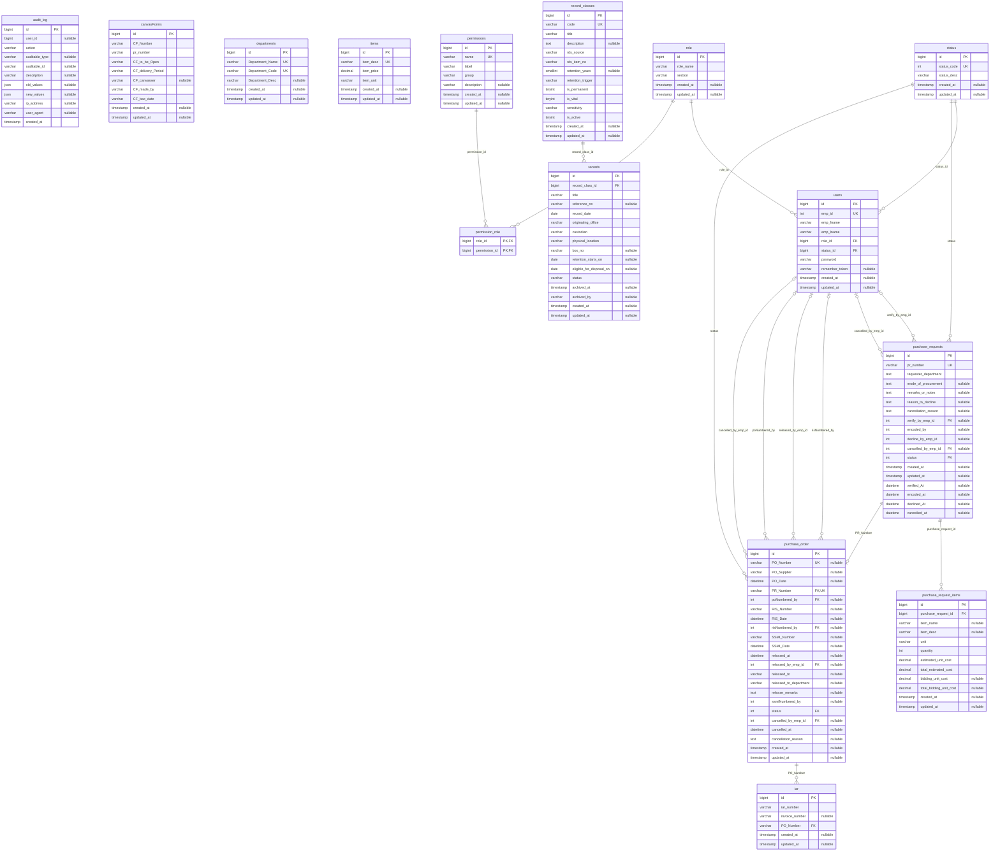

# Entity Relationship Diagram

> Generated by `php artisan erd:generate` on Sep 16, 2026 2:19 PM PST from the `GSONEO` database.
> For pan, zoom and search, open the Docs → ERD page in the app.
> Do not edit by hand — run the command again after migrations change.

**15 tables · 16 relationships.** Lines come from database foreign keys only.

Cardinality: `||` exactly one, `|o` zero or one, `o{` zero or many.

## Relationships

| Child table | Column | References | Required |
|---|---|---|---|
| `iar` | `PO_Number` | `purchase_order.PO_Number` | Yes |
| `permission_role` | `permission_id` | `permissions.id` | Yes |
| `permission_role` | `role_id` | `role.id` | Yes |
| `purchase_order` | `cancelled_by_emp_id` | `users.emp_id` | No |
| `purchase_order` | `poNumbered_by` | `users.emp_id` | No |
| `purchase_order` | `PR_Number` | `purchase_requests.pr_number` | Yes |
| `purchase_order` | `released_by_emp_id` | `users.emp_id` | No |
| `purchase_order` | `risNumbered_by` | `users.emp_id` | No |
| `purchase_order` | `status` | `status.status_code` | Yes |
| `purchase_request_items` | `purchase_request_id` | `purchase_requests.id` | Yes |
| `purchase_requests` | `cancelled_by_emp_id` | `users.emp_id` | No |
| `purchase_requests` | `status` | `status.status_code` | Yes |
| `purchase_requests` | `verify_by_emp_id` | `users.emp_id` | No |
| `records` | `record_class_id` | `record_classes.id` | Yes |
| `users` | `role_id` | `role.id` | Yes |
| `users` | `status_id` | `status.id` | Yes |

## Tables

### `audit_log`

| Column | Type | Nullable | Default | Key |
|---|---|---|---|---|
| `id` | bigint unsigned auto_increment | No | — | PK |
| `user_id` | bigint unsigned | Yes | — |  |
| `action` | varchar(255) | No | — |  |
| `auditable_type` | varchar(255) | Yes | — |  |
| `auditable_id` | varchar(255) | Yes | — |  |
| `description` | varchar(255) | Yes | — |  |
| `old_values` | json | Yes | — |  |
| `new_values` | json | Yes | — |  |
| `ip_address` | varchar(255) | Yes | — |  |
| `user_agent` | varchar(255) | Yes | — |  |
| `created_at` | timestamp | No | `CURRENT_TIMESTAMP` |  |

### `canvasForms`

| Column | Type | Nullable | Default | Key |
|---|---|---|---|---|
| `id` | bigint unsigned auto_increment | No | — | PK |
| `CF_Number` | varchar(255) | No | — |  |
| `pr_number` | varchar(255) | No | — |  |
| `CF_to_be_Open` | varchar(255) | No | — |  |
| `CF_delivery_Period` | varchar(255) | No | — |  |
| `CF_canvasser` | varchar(255) | Yes | — |  |
| `CF_made_by` | varchar(255) | No | — |  |
| `CF_bac_date` | varchar(255) | No | — |  |
| `created_at` | timestamp | Yes | — |  |
| `updated_at` | timestamp | Yes | — |  |

### `departments`

| Column | Type | Nullable | Default | Key |
|---|---|---|---|---|
| `id` | bigint unsigned auto_increment | No | — | PK |
| `Department_Name` | varchar(255) | No | — | Unique |
| `Department_Code` | varchar(255) | No | — | Unique |
| `Department_Desc` | varchar(255) | Yes | — |  |
| `created_at` | timestamp | Yes | — |  |
| `updated_at` | timestamp | Yes | — |  |

### `iar`

| Column | Type | Nullable | Default | Key |
|---|---|---|---|---|
| `id` | bigint unsigned auto_increment | No | — | PK |
| `iar_number` | varchar(255) | No | — |  |
| `invoice_number` | varchar(255) | Yes | — |  |
| `PO_Number` | varchar(255) | No | — | FK |
| `created_at` | timestamp | Yes | — |  |
| `updated_at` | timestamp | Yes | — |  |

### `items`

| Column | Type | Nullable | Default | Key |
|---|---|---|---|---|
| `id` | bigint unsigned auto_increment | No | — | PK |
| `item_desc` | varchar(255) | No | — | Unique |
| `item_price` | decimal(12,2) | No | — |  |
| `item_unit` | varchar(20) | No | — |  |
| `created_at` | timestamp | Yes | — |  |
| `updated_at` | timestamp | Yes | — |  |

### `permission_role`

| Column | Type | Nullable | Default | Key |
|---|---|---|---|---|
| `role_id` | bigint unsigned | No | — | PK, FK |
| `permission_id` | bigint unsigned | No | — | PK, FK |

### `permissions`

| Column | Type | Nullable | Default | Key |
|---|---|---|---|---|
| `id` | bigint unsigned auto_increment | No | — | PK |
| `name` | varchar(100) | No | — | Unique |
| `label` | varchar(255) | No | — |  |
| `group` | varchar(100) | No | — |  |
| `description` | varchar(255) | Yes | — |  |
| `created_at` | timestamp | Yes | — |  |
| `updated_at` | timestamp | Yes | — |  |

### `purchase_order`

| Column | Type | Nullable | Default | Key |
|---|---|---|---|---|
| `id` | bigint unsigned auto_increment | No | — | PK |
| `PO_Number` | varchar(255) | Yes | — | Unique |
| `PO_Supplier` | varchar(255) | Yes | — |  |
| `PO_Date` | datetime | Yes | — |  |
| `PR_Number` | varchar(255) | No | — | FK, Unique |
| `poNumbered_by` | int | Yes | — | FK |
| `RIS_Number` | varchar(255) | Yes | — |  |
| `RIS_Date` | datetime | Yes | — |  |
| `risNumbered_by` | int | Yes | — | FK |
| `SSMI_Number` | varchar(255) | Yes | — |  |
| `SSMI_Date` | datetime | Yes | — |  |
| `released_at` | datetime | Yes | — |  |
| `released_by_emp_id` | int | Yes | — | FK |
| `released_to` | varchar(255) | Yes | — |  |
| `released_to_department` | varchar(255) | Yes | — |  |
| `release_remarks` | text | Yes | — |  |
| `ssmiNumbered_by` | int | Yes | — |  |
| `status` | int unsigned | No | — | FK |
| `cancelled_by_emp_id` | int | Yes | — | FK |
| `cancelled_at` | datetime | Yes | — |  |
| `cancellation_reason` | text | Yes | — |  |
| `created_at` | timestamp | Yes | — |  |
| `updated_at` | timestamp | Yes | — |  |

### `purchase_request_items`

| Column | Type | Nullable | Default | Key |
|---|---|---|---|---|
| `id` | bigint unsigned auto_increment | No | — | PK |
| `purchase_request_id` | bigint unsigned | No | — | FK |
| `item_name` | varchar(255) | Yes | — |  |
| `item_desc` | varchar(255) | Yes | — |  |
| `unit` | varchar(255) | No | — |  |
| `quantity` | int | No | — |  |
| `estimated_unit_cost` | decimal(10,2) | No | — |  |
| `total_estimated_cost` | decimal(10,2) | No | — |  |
| `bidding_unit_cost` | decimal(10,2) | Yes | — |  |
| `total_bidding_unit_cost` | decimal(10,2) | Yes | — |  |
| `created_at` | timestamp | Yes | — |  |
| `updated_at` | timestamp | Yes | — |  |

### `purchase_requests`

| Column | Type | Nullable | Default | Key |
|---|---|---|---|---|
| `id` | bigint unsigned auto_increment | No | — | PK |
| `pr_number` | varchar(255) | No | — | Unique |
| `requester_department` | text | No | — |  |
| `mode_of_procurement` | text | Yes | — |  |
| `remarks_or_notes` | text | Yes | — |  |
| `reason_to_decline` | text | Yes | — |  |
| `cancellation_reason` | text | Yes | — |  |
| `verify_by_emp_id` | int | Yes | — | FK |
| `encoded_by` | int | Yes | — |  |
| `decline_by_emp_id` | int | Yes | — |  |
| `cancelled_by_emp_id` | int | Yes | — | FK |
| `status` | int unsigned | No | `0` | FK |
| `created_at` | timestamp | Yes | — |  |
| `updated_at` | timestamp | Yes | — |  |
| `verified_At` | datetime | Yes | — |  |
| `encoded_at` | datetime | Yes | — |  |
| `declined_At` | datetime | Yes | — |  |
| `cancelled_at` | datetime | Yes | — |  |

### `record_classes`

| Column | Type | Nullable | Default | Key |
|---|---|---|---|---|
| `id` | bigint unsigned auto_increment | No | — | PK |
| `code` | varchar(30) | No | — | Unique |
| `title` | varchar(255) | No | — |  |
| `description` | text | Yes | — |  |
| `rds_source` | varchar(50) | No | — |  |
| `rds_item_no` | varchar(30) | No | — |  |
| `retention_years` | smallint unsigned | Yes | — |  |
| `retention_trigger` | varchar(40) | No | — |  |
| `is_permanent` | tinyint(1) | No | `0` |  |
| `is_vital` | tinyint(1) | No | `0` |  |
| `sensitivity` | varchar(20) | No | `internal` |  |
| `is_active` | tinyint(1) | No | `1` |  |
| `created_at` | timestamp | Yes | — |  |
| `updated_at` | timestamp | Yes | — |  |

### `records`

| Column | Type | Nullable | Default | Key |
|---|---|---|---|---|
| `id` | bigint unsigned auto_increment | No | — | PK |
| `record_class_id` | bigint unsigned | No | — | FK |
| `title` | varchar(255) | No | — |  |
| `reference_no` | varchar(100) | Yes | — |  |
| `record_date` | date | No | — |  |
| `originating_office` | varchar(255) | No | — |  |
| `custodian` | varchar(255) | No | — |  |
| `physical_location` | varchar(255) | No | — |  |
| `box_no` | varchar(50) | Yes | — |  |
| `retention_starts_on` | date | Yes | — |  |
| `eligible_for_disposal_on` | date | Yes | — |  |
| `status` | varchar(30) | No | `active` |  |
| `archived_at` | timestamp | Yes | — |  |
| `archived_by` | varchar(20) | Yes | — |  |
| `created_at` | timestamp | Yes | — |  |
| `updated_at` | timestamp | Yes | — |  |

### `role`

| Column | Type | Nullable | Default | Key |
|---|---|---|---|---|
| `id` | bigint unsigned auto_increment | No | — | PK |
| `role_name` | varchar(255) | No | — |  |
| `section` | varchar(255) | No | — |  |
| `created_at` | timestamp | Yes | — |  |
| `updated_at` | timestamp | Yes | — |  |

### `status`

| Column | Type | Nullable | Default | Key |
|---|---|---|---|---|
| `id` | bigint unsigned auto_increment | No | — | PK |
| `status_code` | int unsigned | No | — | Unique |
| `status_desc` | varchar(255) | No | — |  |
| `created_at` | timestamp | Yes | — |  |
| `updated_at` | timestamp | Yes | — |  |

### `users`

| Column | Type | Nullable | Default | Key |
|---|---|---|---|---|
| `id` | bigint unsigned auto_increment | No | — | PK |
| `emp_id` | int | No | — | Unique |
| `emp_fname` | varchar(255) | No | — |  |
| `emp_lname` | varchar(255) | No | — |  |
| `role_id` | bigint unsigned | No | — | FK |
| `status_id` | bigint unsigned | No | `17` | FK |
| `password` | varchar(255) | No | — |  |
| `remember_token` | varchar(100) | Yes | — |  |
| `created_at` | timestamp | Yes | — |  |
| `updated_at` | timestamp | Yes | — |  |
